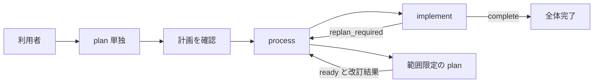

# 開発プロセス — Skill 化前のプロンプト原稿

## この資料の使い方

このディレクトリには、開発プロセスを各 Skill へ落とし込むためのプロンプト原稿を置く。各役が受け取るもの、行う仕事、判断すること、呼び出し元へ返すものを確認するための原稿である。役割の本文は、その役を担当する agent への指示として記述している。配布用の `SKILL.md`、UI メタデータ、参照ファイル、補助スクリプトは `skills/` 配下に配置されている。

最初は [process](fm-dev-process.md) → [plan](fm-dev-plan.md) → [implement](fm-dev-implement.md) を読み、工程の切り替えと leader の仕事を確認する。次に、確認したい専門役の本文へ進む。プロンプトを実際の依頼に使う場合は、対象の本文と、そこから指定された共通資料・対象プロジェクトの資料を渡す。

## 共通資料・関連資料

| 資料 | 内容 | 読む場面 |
| --- | --- | --- |
| [00_common.md](00_common.md) | 要求の根拠、階層間の入出力、記録・判定の権限、証跡と終了の共通ルール | 担当する役のプロンプトと併せて読む |
| [00_documents.md](00_documents.md) | Patch / Light / Full、既存ドキュメントの役割・記録例、90と再計画の記録 | 計画、文書作成、進捗記録、再開で必要な節を読む |
| [artifact-identity.md](artifact-identity.md) | 成果版・fixture 同一性確認ツール（`artifact_identity.py`）の使い方と方式 | 機械IDで同一性確認を補助する場合に読む（利用は任意） |
| [UPDATE.md](UPDATE.md) | 開発プロセス文書の版更新履歴（01〜現行版） | 過去の改訂経緯を確認する場合に読む |

これらは参照資料であり、追加の専門役や通過すべき工程ではない。

## 役割別プロンプト

| 階層 | 原稿 / 対応する Skill | 行うこと | 返すもの |
| --- | --- | --- | --- |
| Lv.1 | [fm-dev-process](fm-dev-process.md) | Lv.2 の結果を受けて工程を切り替える | 全体完了、または判断・再開の引き渡し |
| Lv.2 | [fm-dev-plan](fm-dev-plan.md) | 必要な専門役を呼び、初回計画・範囲限定の再計画を進める | 利用可能な計画、改訂内容と見直し指示、または不足 |
| Lv.2 | [fm-dev-implement](fm-dev-implement.md) | 作業計画・実装・テスト・受け入れ・完了処理を進める | 完了、再計画要求、または不足 |
| Lv.3 | [fm-dev-requirement](fm-dev-requirement.md) | 目的・範囲・要求・受け入れ条件を具体化する | 要求資料、根拠、未決事項、変更案 |
| Lv.3 | [fm-dev-cheatsheet](fm-dev-cheatsheet.md) | 指定されたドメイン・技術の問いを調査する | 調査・観測結果、制約、再利用可能な知識 |
| Lv.3 | [fm-dev-architect](fm-dev-architect.md) | 要求を構造・振る舞い・インターフェースへ設計する | 実装仕様、判断根拠、変更影響 |
| Lv.3 | [fm-dev-taskplanner](fm-dev-taskplanner.md) | 作業単位・依存・達成条件・確認手順を組み立てる | WP、統合・再開の作業計画 |
| Lv.3 | [fm-dev-reviewer](fm-dev-reviewer.md) | 次の作業に必要な計画の十分さ・整合・粒度を確認する | 進められる範囲と根拠付きの不足 |
| Lv.3 | [fm-dev-develop](fm-dev-develop.md) | 指定範囲を実装・統合し、内部確認する | 実装成果、確認結果、未達・仕様上の問題 |
| Lv.3 | [fm-dev-tester](fm-dev-tester.md) | 計画時を含めテストを設計・作成・実行する | 手順・コード、期待と実際、観測限界 |
| Lv.3 | [fm-dev-acceptance](fm-dev-acceptance.md) | 合意条件に対して実装成果を独立に確認する | REQ ごとの判定・根拠・不足 |
| Lv.3 | [fm-dev-release](fm-dev-release.md) | 受け入れ済み成果の文書反映・引き渡しを行う | 完了処理の成果と残件 |

## 役割別の読み始めガイド

以下は、必要な節へ早く到達するための入口です。`00_common.md`の共通ルールと、担当役本文の指示は省略せず適用してください。`00_documents.md`は必要な作業に関係する節を参照し、無関係な記入例・成果物の全文を毎回読み込む必要はありません。節名は見出しの正式名称で示します。丸括弧内はその節にある表・記入例を指します。

| 役 | 最初に読む節 |
| --- | --- |
| process | `00_common`: 必須の実行契約、役割と制御、返却する内容、反復と終了。`00_documents`: プロセス区分と保存場所、必須の更新タイミング |
| plan | `00_common`: 必須の実行契約、依頼に含める情報、作業結果と証跡、判定と記録の権限、反復と終了（指摘対応モードと修正ラウンド上限はプラン時の合意事項）。`00_documents`: プロセス区分と保存場所、Full の文書、Light の文書、cheatsheet、90_status.md — 唯一の進捗正本、再計画の記録例 |
| implement | `00_common`: 必須の実行契約、目的と判断の根拠（Patchの差異判別）、検証範囲、作業結果と証跡、デバッグの内側ループとhelp・フロー後退、判定と記録の権限、返却する内容、反復と終了（指摘対応モード）。`00_documents`: プロセス区分と保存場所、REQの実装・受け入れ、再計画の記録例、必須の更新タイミング |
| requirement | `00_common`: 目的と判断の根拠、検証範囲、作業結果と証跡。`00_documents`: Full の文書（30のREQ表）、Light の文書 |
| cheatsheet | `00_common`: 依頼に含める情報、作業結果と証跡、返却する内容。`00_documents`: cheatsheet |
| architect | `00_common`: 目的と判断の根拠、検証範囲、作業結果と証跡。`00_documents`: Full の文書（40・42とWP表）、cheatsheet |
| taskplanner | `00_common`: 依頼に含める情報、作業結果と証跡、判定と記録の権限。`00_documents`: Full の文書（41のWP表） |
| reviewer | `00_common`: 目的と判断の根拠、検証範囲、作業結果と証跡、判定と記録の権限、返却する内容（指摘レベル）。`00_documents`: 人が読むレビュー資料、Full の文書（30・40・41・42）、90_status.md — 唯一の進捗正本 |
| develop | `00_common`: 検証範囲、作業結果と証跡、デバッグの内側ループとhelp・フロー後退、判定と記録の権限、返却する内容。`00_documents`: プロセス区分と保存場所、REQの実装・受け入れ、再計画の記録例 |
| tester | `00_common`: 検証範囲、作業結果と証跡、デバッグの内側ループとhelp・フロー後退、判定と記録の権限、返却する内容。`00_documents`: Full の文書（30の確認方法）、cheatsheet |
| acceptance | `00_common`: 検証範囲、作業結果と証跡、デバッグの内側ループとhelp・フロー後退、判定と記録の権限、返却する内容（指摘レベルはAcceptance判定とは別欄）。`00_documents`: REQの実装・受け入れ、旧形式からの再開 |
| release | `00_common`: 作業結果と証跡、判定と記録の権限、返却する内容。`00_documents`: current docs とプラン索引、cheatsheet、91_worklog.md — 任意の判断経緯 |

## 実行パターン

- 一連の工程を任せる: process に要望または既存計画を渡す。
- 計画だけ確認する: plan に要望を渡し、返された資料を読む。
- 確認済み計画から自動実装する: process に対象計画を渡す。記録された開始条件が揃っていれば implement から始まる。
- 実装だけ任せる: implement に対象計画を渡す。再計画が必要になったら要求を受け取り、利用者が plan、その後 implement または process を実行する。

## 確認してほしい境界

- トップのagentがLv.1 / Lv.2のleader業務を兼任し、Lv.3専門役を実際にsubagentとして起動して対象役の本文を指定して依頼し、結果を取得する。役名だけを切り替えて専門作業を自己代行しない。
- Light / Fullでは、計画文書と90をファイルとして保存する。開始・依頼・結果回収・再計画・返却に応じて90を参照・更新し、その内容と成果・報告が一致してから次へ進む。
- Lv.3 は必要に応じて再度呼べる専門役であり、他の役を起動しない。
- Lv.2 は自分の工程内を制御し、plan と implement の切り替えは Lv.1 または利用者が行う。
- plan が改訂結果を返し、implement が実装・状態への取り込みと再実行を担当する。
- 受け入れの判断は acceptance、90への記録はその報告を受けた leader が行う。
- 検証範囲は計画時に具体化する。`release / lite / prototype` の固定プリセットは設けない。
- 12本の存在は、毎回12役を起動するという意味ではない。

## 旧資料からの引き継ぎ

旧版の `15_process.md` から docs-first、要求の根拠、文書成果物、調査知見、Patch / Light / Full を引き継ぐ。旧版の `06_implement.md` から実装と独立受け入れの分離、証跡、差分に応じた見直し、知識の引き渡しを引き継ぐ（各版の改訂経緯は [UPDATE.md](UPDATE.md) を参照）。

旧資料の固定した工程順、旧4役の配置、検証レベル、特定モデル・セッション寿命、2 Skill の独立配布は、新しい合意に従って再構成した。旧資料のファイル自体は現在このリポジトリには同梱していない。

## Skill 化するとき

各役の本文と必要な共通規範を、計画で定めた Skill 本文・同梱参照へ移す。制作上の案内や過去の計画を、配布 Skill の実行依存にしない。共通の文書形式・返却結果・権限を変える場合は、関係する原稿と計画も揃える。

Lv.1 / Lv.2の役割宣言、子agentへの実際の委譲、90に従う進行と継続更新、開始条件、返却結果の照合、終了条件は、各`SKILL.md`本体に残す。共通資料へのリンクや「必要に応じて参照」だけに置き換えない。詳細手順を参照ファイルへ分ける場合は、どの作業の前に必ず読み、何を実行するかを入口に明記する。90の運用契約は必読の文書規則に置き、記入例だけを集めたテンプレートに埋め込まない。

配布は、12本の役割Skillと`fm-dev-process`を同一のskills親ディレクトリへ入れる。Lv.3の本文は `../fm-dev-process/references/` の共通資料を参照するため、この相対パスが解決できる構成を配布の前提とする。単体のSkillだけを別の場所へ置くと、共通契約と文書規則へ到達できない。

Skill化では指示の対象・義務・条件・例外・返却先を維持する。分割先を含む本文と原稿を照合し、参照パスや見出しの変更と、指示内容の変更を区別して確認する。descriptionと起動用プロンプトも、leaderとして委譲する役割と整合させる。

この原稿の確認と、生成後の Skill の構造検査・シナリオレビュー・受け入れは別に記録する。原稿を作成したことだけで、Skill の実装や実動作が完了したとは扱わない。
